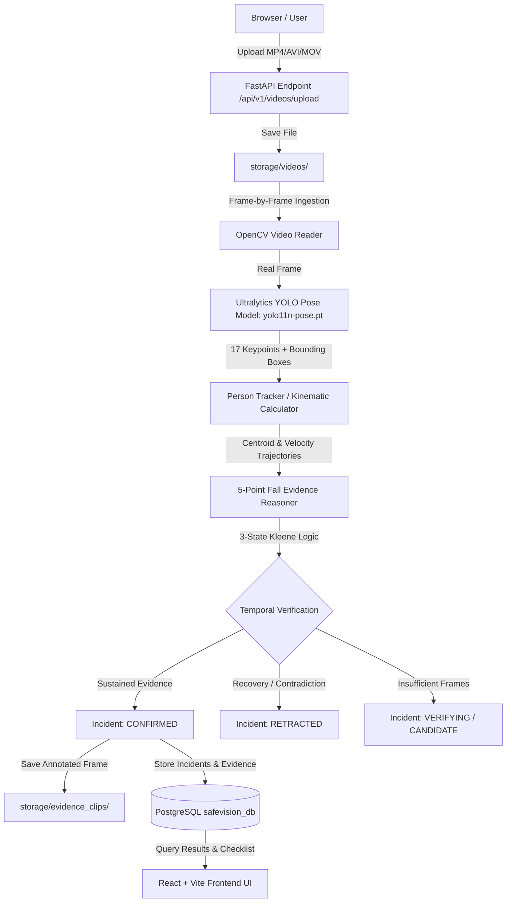

# SafeVision AI
### Context-Aware Autonomous Safety Event Detection and Evidence Verification System
**Problem Statement ID**: HNX26PSI07 — Autonomous Vision & Behaviour Understanding

> **Disclaimer**: *This is an MVP fall-event detector and research prototype, not a certified life-safety or medical diagnostic system.*

---

## 1. Project Purpose & Problem Statement

Modern video surveillance systems generate immense false alarm noise by flagging generic "abnormal movements" without situational context. Everyday human activities—such as sitting down, bending down to tie a shoelace, kneeling, or transient occlusions—are frequently misclassified as safety anomalies.

**SafeVision AI** is an autonomous video safety monitoring system that detects predefined, safety-critical events using **multi-frame evidence verification** and **reversible incident reasoning**. Rather than making single-frame snap judgements, the system extracts spatio-temporal evidence over sliding time windows and verifies required conditions before triggering alerts.

---

## 2. Phase 2 Architecture: Real Video Upload & Fall Detection

SafeVision AI Phase 2 delivers a **real end-to-end computer-vision inference pipeline**:



---

## 3. Fall Detection Methodology & Kinematics

Rather than treating "person horizontal" as the only criterion, SafeVision AI performs **multi-frame temporal reasoning** across the following kinematic signals:

1. **Torso Inclination Angle ($\theta_{\text{torso}}$)**: Angle between horizontal axis and shoulder-to-hip vector.
   - $\theta_{\text{torso}} \ge 60^\circ$: Upright standing posture.
   - $\theta_{\text{torso}} \le 45^\circ$: Horizontal / prone posture.
2. **Aspect Ratio Collapse**: Bounding box width-to-height ratio ($W/H$).
   - $W/H \ge 1.05$: Posture collapse / prone geometry on ground.
3. **Downward Velocity Spike ($\Delta Y / \Delta t$)**: Normalized box centroid downward velocity.
   - $\Delta Y / \Delta t \ge 0.20$ normalized units/sec: Sudden vertical descent.
4. **Sustained Ground Persistence**: Person must remain low/prone for at least $N \ge 8$ consecutive frames.
5. **Recovery Contradiction**: If person resumes upright spinal alignment ($\theta_{\text{torso}} \ge 60^\circ$) within observation window, incident state reverts to `RETRACTED`.

### 5-Point Evidence Schema & 3-State Logic

Every potential fall is evaluated against 5 empirical signals using **3-State Logic** (`SUPPORTED`, `CONTRADICTED`, `UNKNOWN`):

| Signal | Description | Evaluated Condition |
|---|---|---|
| `rapid_downward_velocity` | Rapid descent spike | Vertical centroid velocity $\ge 0.20$ delta Y/s |
| `posture_transition_collapse` | Transition from upright to prone | Previous upright baseline with current prone posture |
| `ground_level_orientation` | Horizontal body axis | Torso angle $\le 45^\circ$ or $W/H \ge 1.05$ |
| `sustained_ground_persistence` | Person remains on ground | Continuous prone state for $\ge 8$ frames |
| `recovery_absence` | Absence of standing recovery | Checks if subject stands back up (`CONTRADICTED` if standing) |

### Reversible Incident Lifecycle

$$\text{CANDIDATE} \longleftrightarrow \text{VERIFYING} \longrightarrow \text{CONFIRMED} \quad \text{or} \quad \text{RETRACTED}$$

---

## 4. Technology Stack

- **Frontend**: React 18, Vite, TypeScript, Tailwind CSS, Lucide Icons, Axios, HTML5 Video Player.
- **Backend**: Python 3.12, FastAPI, SQLAlchemy 2.0, Alembic, Pydantic v2, native bcrypt, Python-JOSE.
- **AI & Computer Vision**: OpenCV (headless), Ultralytics YOLO (`yolo11n-pose.pt`), PyTorch, NumPy.
- **Database**: PostgreSQL 16 (Local cluster or Docker).
- **Storage**: `storage/videos/` (uploaded videos), `storage/evidence_clips/` (annotated evidence frames).

---

## 5. Setup & Running Guide

### 1. PostgreSQL Database Setup

PostgreSQL 16 is configured to run on `localhost:5432` with database `safevision_db`:

```powershell
# Start local PostgreSQL service (or via pg_ctl)
.\backend\pgsql\bin\pg_ctl.exe -D .\backend\pgsql\data -l .\backend\pgsql\logfile.log start

# Run Alembic migrations to create all 8 tables
cd backend
.\venv\Scripts\alembic upgrade head
```

Verify connection:
```bash
curl http://127.0.0.1:8000/api/health/database
# Returns: {"status":"connected","database":"postgresql","connected":true}
```

### 2. Backend Startup

```powershell
cd backend
.\venv\Scripts\uvicorn backend.app.main:app --host 127.0.0.1 --port 8000 --reload
```

### 3. Frontend Startup

```powershell
cd frontend
npm run dev -- --host 127.0.0.1 --port 5173
```

Open browser at: `http://127.0.0.1:5173/`

---

## 6. API Endpoints

### Video & Fall Detection APIs

| Method | Endpoint | Description |
|---|---|---|
| `POST` | `/api/v1/videos/upload` | Multipart video upload with validation (MP4, AVI, MOV, WebM, MKV; max 100MB) |
| `POST` | `/api/v1/videos/{video_id}/process` | Executes real frame-by-frame YOLO Pose inference, tracking, and evidence reasoning |
| `GET` | `/api/v1/videos/{video_id}/status` | Live polling endpoint for job progress percentage (0-100%) |
| `GET` | `/api/v1/videos/{video_id}/results` | Detailed results containing detected incidents, evidence items, and timestamps |
| `GET` | `/api/v1/videos/{video_id}/stream` | Stream uploaded video with HTTP range-request support for browser seeking |
| `GET` | `/api/v1/videos/evidence/{filename}` | Retrieve OpenCV-annotated evidence frame with skeletal overlay and HUD banner |
| `GET` | `/api/v1/incidents/{incident_id}` | Retrieve incident details with linked entity and 3-state evidence checklist from PostgreSQL |

### Health Endpoints

| Method | Endpoint | Description |
|---|---|---|
| `GET` | `/api/health` | Standard API health |
| `GET` | `/api/health/database` | Direct PostgreSQL connectivity status |

---

## 7. Running Tests & Verification

```powershell
# Run the complete test suite (14 unit & integration tests)
cd backend
.\venv\Scripts\pytest tests -v

# Run the end-to-end real video pipeline verification script
.\venv\Scripts\python backend/scripts/verify_end_to_end_fall_pipeline.py
```

### Test Coverage:
- `test_fall_state_machine.py`: Multi-frame state transitions (`NORMAL` $\rightarrow$ `CONFIRMED` and `VERIFYING` $\rightarrow$ `RETRACTED`).
- `test_evidence_reasoner.py`: False positive prevention (slow sitting down $\ne$ fall) and 5-point evidence checklist verification.
- `test_video_api.py`: Upload validation, unsupported format rejection, status and results endpoints.
- `test_incident_db.py`: PostgreSQL persistence of Camera, TrackedEntity, Incident, and Evidence models.
- `test_health.py` & `test_models.py`: Database health check, password hashing, relational integrity.

---

## 8. Configuration Parameters (`backend/app/core/fall_config.py`)

| Parameter | Default | Description |
|---|---|---|
| `MODEL_NAME` | `yolo11n-pose.pt` | Pretrained YOLO pose model weights |
| `PERSON_DETECTION_CONFIDENCE` | `0.40` | Minimum bounding box confidence for person class |
| `KEYPOINT_CONFIDENCE_THRESHOLD` | `0.30` | Minimum keypoint detection confidence |
| `TORSO_ANGLE_HORIZONTAL_THRESHOLD_DEG` | `45.0°` | Torso angle below which posture is considered prone |
| `TORSO_ANGLE_UPRIGHT_THRESHOLD_DEG` | `60.0°` | Torso angle above which posture is considered upright |
| `ASPECT_RATIO_COLLAPSE_THRESHOLD` | `1.05` | Width/Height ratio indicating horizontal collapse |
| `DOWNWARD_VELOCITY_THRESHOLD` | `0.20` | Minimum normalized vertical velocity (delta Y/s) |
| `MIN_PERSISTENCE_FRAMES` | `8` | Consecutive frames on ground required to confirm fall |
| `RECOVERY_WINDOW_FRAMES` | `25` | Observation window for standing recovery |
| `MAX_TRACK_DISTANCE` | `0.45` | Centroid association distance for continuous tracking |

---

## 9. Known Limitations (Phase 2 MVP)

1. **Severe Occlusions**: If a person falls behind heavy furniture, keypoint confidence drops to `UNKNOWN`.
2. **Camera Angles**: Optimal performance is achieved on elevated surveillance cameras (2.5m - 5m mounting height). Extreme top-down (birds-eye) views compress the vertical axis and require tailored homography calibration.
3. **Multi-Person Overlap**: Fast occlusions in dense crowds may cause temporary track ID swaps.
4. **Single-Node Processing**: Processing is executed locally on CPU/GPU. Distributed Celery/Redis queue workers will be added in Phase 3.
