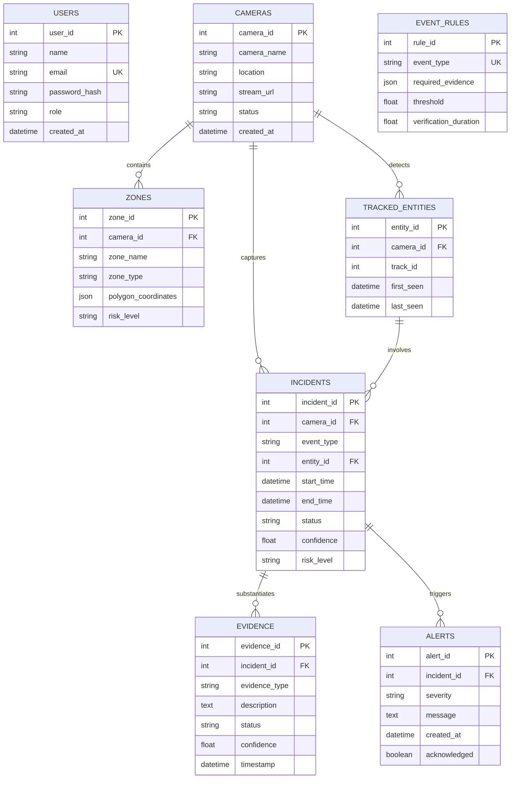

# SafeVision AI - Database Architecture & Schema

SafeVision AI uses PostgreSQL for metadata, entity tracking histories, incident lifecycles, structured evidence records, and alert distribution. Raw video files and binary clips are persisted in storage volumes.

## Relational Entity-Relationship Summary

## Enums and Constraints
- **Incident Status**: `CANDIDATE`, `VERIFYING`, `CONFIRMED`, `RETRACTED`
- **Evidence Status**: `SUPPORTED`, `CONTRADICTED`, `UNKNOWN`
- **User Roles**: `admin`, `operator`, `analyst`, `viewer`
- **Camera Status**: `active`, `inactive`, `error`, `maintenance`
- **Zone Types**: `restricted`, `hazard`, `monitored`, `entry_exit`, `crowd_watch`
- **Risk Levels / Severities**: `low`, `medium`, `high`, `critical`
