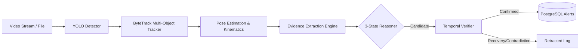

# SafeVision AI - System Architecture

## Problem Statement Alignment: HNX26PSI07
**Autonomous Vision & Behaviour Understanding** requires intelligent surveillance that tracks multiple entities in high-traffic environments, understands contextual behaviours, distinguishes benign human activities from true safety-critical threats, and identifies *what happened*, *who was involved*, and *when the event occurred*.

SafeVision AI rejects ambiguous "weird behaviour detection" in favor of **Context-Aware Safety-Event Detection and Multi-Frame Evidence Verification**.

---

## 5 Core Differentiating Features

### 1. Event-Specific Evidence Schema
Each critical safety event requires a structured checklist of empirical multi-frame observations before an alert is confirmed:
- **Fall / Person Down**: Upright posture history $\rightarrow$ downward vertical velocity $\rightarrow$ posture collapse $\rightarrow$ horizontal ground orientation $\rightarrow$ ground dwell persistence $\rightarrow$ recovery check.
- **Restricted-Zone Intrusion**: ByteTrack entity association $\rightarrow$ polygon boundary crossing $\rightarrow$ velocity heading inward $\rightarrow$ restricted zone dwell time $\rightarrow$ schedule context.
- **Fighting / Aggression**: Multi-person proximity $\rightarrow$ high-energy motion flux $\rightarrow$ rapid acceleration $\rightarrow$ sustained agitation (>2.0s).
- **Crowd / Overcrowding**: Entity count $\rightarrow$ spatial concentration $\rightarrow$ positive accumulation rate $\rightarrow$ bottleneck dwell slowdown.

### 2. Three-State Evidence Reasoning
Every evidence item evaluates to one of three discrete truth states:
- `SUPPORTED`: Positive empirical verification across frames.
- `CONTRADICTED`: Observed evidence directly refutes the event premise.
- `UNKNOWN`: Partial occlusion, out-of-frame limbs, or sensor ambiguity. **Crucially, `UNKNOWN` is never coerced into `FALSE`**, avoiding erroneous event dismissals.

### 3. Reversible Incident Lifecycle
Incidents transition through a deterministic finite-state lifecycle:
```
[ CANDIDATE ] ──(evidence accumulation)──> [ VERIFYING ] ──(evidence complete)──> [ CONFIRMED ]
       │                                         │
       └──(contradiction / recovery)─────────────┴──────> [ RETRACTED ]
```

### 4. Evidence-Complete Alerting
Alerts are generated **only when the complete evidence requirements are satisfied**. Single-frame anomalies are filtered out automatically.

### 5. Multi-Frame Temporal Lifecycle
Sliding temporal buffers preserve motion continuity and differentiate transient behaviors (e.g., tying a shoe or picking up an item) from true safety hazards.

---

## Non-LLM Decision Architecture
All core safety detections, tracking associations, kinematic measurements, and evidence evaluations are executed by deterministic computer vision and rule-based evidence engines. LLMs are strictly forbidden from acting as safety decision makers; an LLM may only be leveraged in auxiliary natural-language summarization modules.

---

## High-Level Pipeline Diagram


